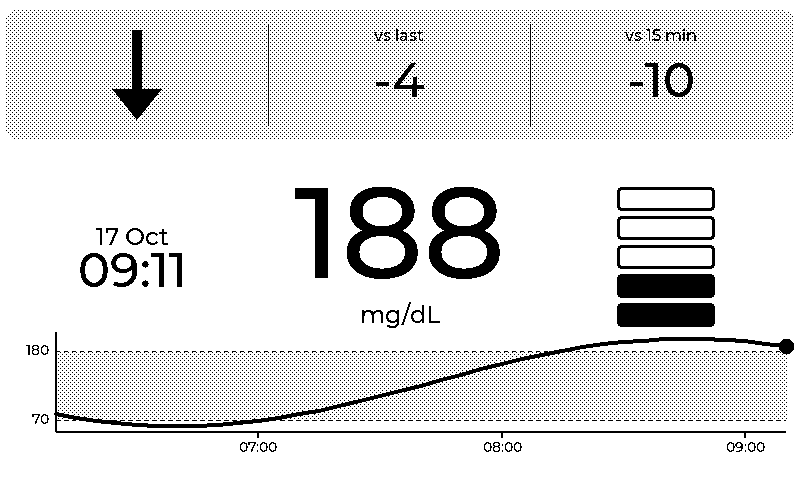
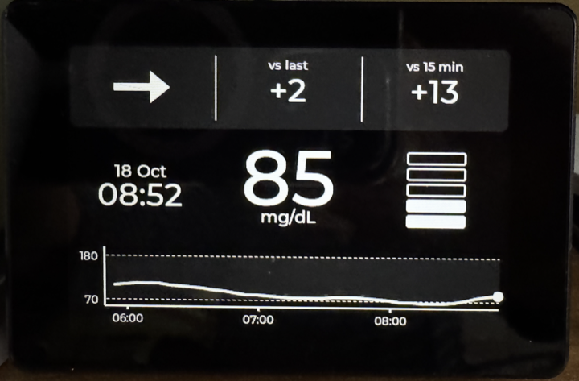
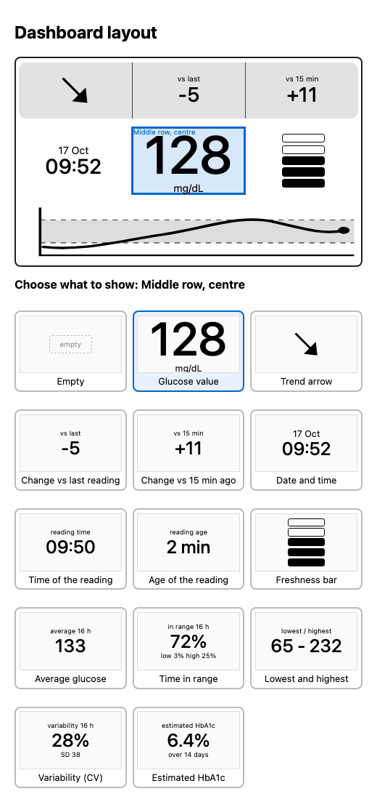

# GlucoPanel

Glucose display firmware for ESP32-S3 boards: it shows your current glucose, trend and statistics from Dexcom Share, LibreLinkUp or Nightscout. It supports two displays (two *profiles* of the same code):

| Profile | Hardware | Screen | Input |
| --- | --- | --- | --- |
| e-paper (default) | Seeed **reTerminal E1001** (ESP32-S3) | 7.5" 800×480, black and white, partial refresh | two buttons on the back |
| colour LCD | Guition **JC3248W535** (ESP32-S3, 16 MB flash, 8 MB PSRAM) | 3.5" 480×320, colour, capacitive touch | touch screen |

*On a real JC3248W535, in night mode.*

## Medical disclaimer

**GlucoPanel is not a medical device.** It is a hobby project that shows glucose readings fetched from third-party services, and it has not been tested, certified or approved for any medical use.

- **Do not use it to make treatment decisions**, such as insulin dosing or deciding what to eat. Always use your official sensor, reader or app, and its alarms.
- The displayed values can be delayed, wrong, stale or missing: the data comes through unofficial, undocumented APIs that can change or stop working without notice, over a network that can fail, and the panel can crash, lose power or freeze on an old reading. The reading's age is shown for that reason, but check it.
- The statistics (average, time in range, variability) and the **estimated HbA1c** are computed from the readings the panel happened to collect, with gaps; the HbA1c is an estimate (GMI) that can differ from a laboratory result by 0.5 % or more.
- The panel is not a replacement for medical advice. Talk to your healthcare team about your treatment.
- This project is not affiliated with or endorsed by Dexcom, Abbott (FreeStyle Libre / LibreLinkUp), Nightscout or Seeed Studio. The names are used only to say which services it can read.
- It is provided "as is", with no warranty of any kind; see the licence below.

## How it works

1. **Boot.** The panel tries the saved WiFi (up to 20 s).
2. **Saved WiFi can't be joined.** The screen asks whether to erase it:
   - **KEY0 (green):** erase the credentials and go to setup.
   - **KEY1:** retry. With no key pressed it retries by itself after 60 s.
3. **No WiFi saved (or erased).** The panel opens a hotspot named **`GlucoPanel`** with a captive portal. The hotspot is protected (WPA2) by a random password made on first use and kept in flash; the screen shows it as text and inside the first QR code, which joins the hotspot when scanned. The second QR code opens `http://192.168.4.1`.
4. **Connected.** The screen shows the SSID, the IP and a QR code for the settings page, which is also at `http://glucopanel.local`.

### Buttons (e-paper) and touch (LCD)

On the **LCD profile** there are no buttons; the touch screen does the same jobs:

- **Tap** on the dashboard: opens the settings screen (QR code, address, a new 6-digit code). It closes after 60 s or with a tap anywhere else on it.
- **Hold 3 s** on the "Hold 3 s to erase the WiFi" button of that screen: a fill grows across the button, then the saved WiFi is erased and the panel restarts in setup mode. The button is there on purpose: a screen is touched by accident far more easily than a button on the back, so holding "anywhere" would be too easy to trigger.
- **At boot**, if the saved WiFi cannot be joined: two on-screen buttons, "Erase and set up new WiFi" and "Retry".

On the **e-paper profile** the green button (KEY0) does two things:

- **Short press:** shows a screen with a QR code, the address of the settings page and a new 6-digit code (see below). It closes after 60 s or when you press any button.
- **Hold for 3 s:** erases the saved WiFi and restarts in setup mode (the hotspot described above). This also works while the QR screen is up.

The buttons are only read once the panel is running; the boot-time WiFi prompt above uses KEY0 and KEY1 as described.

### Settings page

Open the address shown on the display from any device on the same network.

| Setting | Notes |
| --- | --- |
| Data source | Nightscout (URL, optional token), LibreLinkUp (email, password, region) or Dexcom Share (username, password, server) |
| Display unit | mg/dL or mmol/L |
| Block contents | What each of the seven blocks shows (see below) |
| HbA1c unit | % (NGSP, default) or mmol/mol (IFCC) for the estimated HbA1c block |
| Trusted IP addresses | Optional list of IPv4 addresses or ranges (`192.168.1.20`, `192.168.1.0/24`, separated by commas) whose requests skip the code. See the access note below |
| Check server certificates | Yes (default): HTTPS servers must present a certificate signed by a known authority. No: accept any certificate (insecure) |
| Install updates automatically, Install updates at | Automatic firmware updates from GitHub, On by default, and the hour of the night to install them (default 3, local time). See [Firmware updates](#firmware-updates) |
| Night mode, Night starts / ends at | White-on-black dashboard, always on or on a schedule (see below) |
| Brightness, Night brightness | Backlight levels, colour LCD only |
| Language | English (default), Français, Deutsch, Italiano or Español: the panel screens, the fetch errors and this page |
| Time zone | Used for the HH:MM clock on the dashboard (default Paris / Berlin / Madrid) |
| Low / high thresholds | Always entered in mg/dL; low must be below high |
| Firmware updates | The running version, the result of the last check, a **Check for updates** button and, when there is a newer release, an **Install now** button |
| Erase WiFi | Wipes the saved network and reboots into the `GlucoPanel` hotspot |

The panel then shows the dashboard and refetches on a timer. The screen is a grid of seven blocks (no grid lines are drawn), and **each block's content is chosen in the settings page**, on a miniature of the dashboard: tap a block, then tap one of the preview cards to choose what it shows (plain drop-downs are used if JavaScript is off):

| | | |
| --- | --- | --- |
| top row, left (in the grey band) | top row, middle | top row, right |
| middle row, left | middle row, centre | middle row, right |
| bottom row (full width) | | |

Any of the six small blocks can show: nothing, the **glucose value** (big, with its unit), the **trend arrow**, the **change vs the previous reading**, the **change vs 15 min ago**, the **change vs 30 min ago**, the **date and time** (local, see the time zone setting), the **time of the reading**, the **age of the reading** (minutes), the **freshness bar** (one segment per minute of age, up to 5), or one of four statistics over the collected history: the **average glucose**, the **time in range** (between your low and high limits, with the time below and above), the **lowest and highest** reading, the **variability** (coefficient of variation, with the standard deviation), or the **estimated HbA1c** (see below). The statistics are time-weighted and their caption says how many hours they cover: Dexcom Share returns about the last 16 h in one request, the panel keeps up to 24 h and builds the rest up while it runs (so the figures cover less right after a restart, and LibreLinkUp only offers its graph history). The bottom row shows the **glucose graph** or nothing. The default layout is arrow / change / change, clock / value / freshness bar, graph. The same content can be used in several blocks. The layout is rebuilt when the settings are saved.

*The layout editor on the settings page (here for the middle block): a miniature of the dashboard on top, and below it a preview of every choice for the block you tapped.*

Deltas are in the chosen unit and show `--` until enough history is known. The graph shows the last 3 h as a line (dot on the newest reading), with the low..high thresholds as a light-grey band and the y range following the data (at least 60..200 mg/dL). Readings more than 20 min apart are not joined. A thin strip under it shows the last fetch error. The refresh interval is not a setting: it is fixed by the source (5 min for Dexcom, 1 min for LibreLinkUp and Nightscout).

**Estimated HbA1c.** The block shows the *glucose management indicator* (GMI = 3.31 + 0.02392 × mean glucose in mg/dL, in %; mmol/mol = (% − 2.15) × 10.929). It is an estimate from sensor readings and can differ from a lab HbA1c by 0.5 % or more. Following the usual CGM rule it needs **14 days with at least 70 % of the readings**; until then the block says "Not available yet" and shows how many days of readings it has (for example "0.7 / 14 days"). Daily totals are saved in the panel's flash, so they survive a restart (at most the last 30 min of counting is lost), and gaps in the readings simply count as missing time. The totals belong to the account: they are discarded when the data source or its credentials (including the region) change.

Saved values live in the ESP32's flash. Password fields are never echoed back, and leaving one blank keeps the stored value.

**Access to the settings page.** The page needs a 6-digit **code that only the panel shows**: under the address on the "WiFi connected" and "Not configured" screens, and on the screen opened by a short press of the green button (a new code is made each time). The QR codes on those screens contain the code, so scanning one opens the page directly; otherwise open the address and type the code. A correct code starts a session (a cookie, 30 minutes after the last request); five wrong codes lock the page for a minute. Changing settings or erasing the WiFi therefore takes someone who can see the panel. The code is also printed on the serial console.

**Trusted IP addresses.** Addresses listed in that setting reach the page without a code or session (up to 8 entries, ranges from /8 to /32). Use it for a machine you control, ideally with a fixed address (a DHCP reservation). Another device on the same WiFi can claim the same address, so this trades some of the protection above for convenience; leave it empty if you do not need it. Only someone who already has access (a code, or a trusted address) can change the list.

What this does **not** do: the page is still plain HTTP, so someone who can read your WiFi traffic can see the code and the session cookie; and secrets (the WiFi password, the service credentials) are stored unencrypted in the ESP32's flash, readable by someone with physical access and a cable. Flash encryption would fix the latter, but it is irreversible and makes development harder, so it is not used.

## Night mode

A night mode shows the dashboard **white on black**, set on the settings page (both profiles):

- **Night mode:** Off, On, or Scheduled. Scheduled uses **Night starts at** and **Night ends at** in your time zone; the night may run over midnight (for example 22:00 to 07:00). Until the clock is set (NTP) the schedule counts as day. The settings are looked at every couple of seconds, so a change made on the page shows within moments.
- **How it is drawn:** the colours are inverted when the frame is pushed to the panel, so no widget needed changing. On the e-paper the light grey (a sparse dither) becomes dark grey (mostly black with sparse white dots), and the switch between day and night is a full refresh, twice a day for a schedule. The WiFi and settings screens keep their normal colours, so their QR codes stay easy to scan.
- **Colour LCD only:** the backlight goes to **Night brightness** (default 10 %); **Brightness** (default 100 %) is the level the rest of the time. When the colours and the brightness both change, the colours change first and the brightness second, so the screen never flashes bright in a dark room. The e-paper has no backlight, so these two settings only exist on the LCD profile.

## Firmware updates

The panel can update itself over WiFi from the [GitHub releases](https://github.com/3djc/GlucoPanel/releases) of this project. It is on by default; the **Install updates automatically** setting turns it off, and then the panel makes no update requests at all.

- **Checking:** about 90 s after start-up and then once a day, the panel reads `manifest.json` of the latest release (a few hundred bytes). It also looks once more when the install hour starts.
- **Installing:** a newer release is installed during the hour set by **Install updates at** (default 03:00 to 03:59 in your time zone), and only while the settings screen is closed and no fetch error is showing. The download takes 20 to 40 s, during which the screen shows the progress and the panel does not update the reading, then it restarts. Your settings and WiFi are kept.
- **Safety:** the download is HTTPS with the certificate checked (whatever the "Check server certificates" setting says), the update address must be on `github.com` (which then redirects to its own download servers), and the size and SHA-256 must match the manifest before it is accepted. The new firmware is installed in the second of two app slots; if it does not run for a minute with WiFi connected, the next restart goes back to the previous firmware. A release that fails to install 3 nights in a row is left alone until a newer one appears.
- **By hand:** the **Firmware updates** block of the settings page shows the version and has **Check for updates** and **Install now** buttons, which work whatever the automatic setting says. Flashing an `-update.bin` over USB (see [INSTALL.md](INSTALL.md#updating)) still works too.
- **Not covered:** the manifest is protected by HTTPS and your trust in GitHub, not by a signature of its own. Someone who can publish a release in this repository can update every panel.
- **Development builds** report the version `dev` and are never replaced by an automatic update; only builds made from a release tag (`v1.2.3`) take part.

## Install and build

- **Install a prebuilt firmware** on a device: [INSTALL.md](INSTALL.md).
- **Build from source**, run the simulator, change the code: [BUILD.md](BUILD.md).

## License

Copyright 2026 3djc. Licensed under the [PolyForm Noncommercial License 1.0.0](LICENSE): you may use, modify and share it for any **noncommercial** purpose, which includes personal use, hobby projects, research, education and use by charities and similar organizations. **Commercial use is not permitted** without a separate agreement with the copyright holder. Because of that restriction this is "source-available", not "open source" in the sense of the OSI definition.

Bundled third-party material keeps its own terms: LVGL, ArduinoJson and WiFiManager (MIT), Seeed_GFX (see its repository) and the Montserrat font used for the generated `font_*.c` files (SIL Open Font License 1.1). These are downloaded by PlatformIO at build time, except for the generated fonts that are part of this repository.
